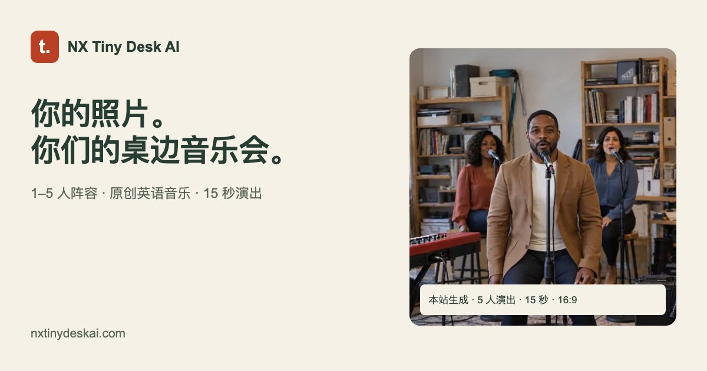
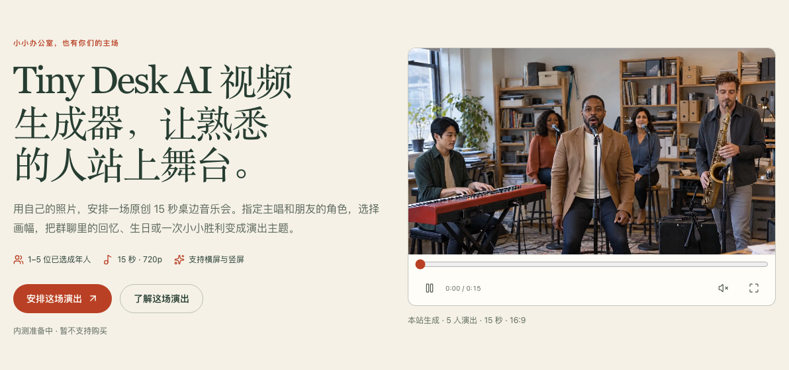
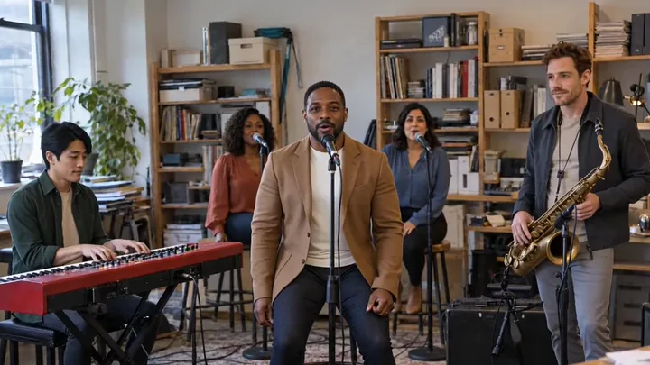

# NX Tiny Desk AI — 用照片制作桌边音乐会视频

把你和朋友的照片变成一场原创桌边音乐会。指定主唱与乐手角色，选择横屏或竖屏，用一个主题记录生日、朋友聚会，或一次值得庆祝的小小胜利。

**[访问官方网站](https://nxtinydeskai.com)** · [进入中文网站](https://nxtinydeskai.com/zh) · [使用教程](https://nxtinydeskai.com/zh/how-to-make-tiny-desk-ai-video) · [反馈与建议](https://github.com/977954608/tiny-desk-ai-showcase/issues)

## 产品功能

- **按实际人数组建阵容：** 支持单人、双人以及 3–5 人阵容，按角色位置上传人物照片。
- **指定演出角色：** 主唱为必选角色；双人可搭配萨克斯或键盘，多人阵容可加入乐手与伴唱。
- **原创音乐与人声：** 输入演出主题，生成原创英语演唱；网站提供中英文界面。
- **固定视频规格：** 15 秒、720p，支持 9:16 竖屏与 16:9 横屏。
- **生成前确认：** 查看已上传人物、所选画幅与积分用量，再确认创建。
- **查看与保存作品：** 在网站播放、下载视频，并在个人中心查看历史任务。

**当前状态：** 网站处于内测准备阶段，暂不支持购买。可用额度和生成入口以网站实际显示为准；本仓库中的样片用于展示，不保证每次生成都能获得相同效果。

## 网站预览

上图为产品界面预览；最新页面与服务状态请查看官方网站。

## 单人、双人与多人样片

| 单人演出 | 双人演出 | 多人演出 |
| --- | --- | --- |
|  |  |  |

以上为本站公开样片的封面。[前往网站观看带声音的视频样片](https://nxtinydeskai.com/zh#examples)。

## 使用步骤

1. [进入网站](https://nxtinydeskai.com/zh)，选择单人、双人或多人阵容。
2. 将清晰的人物照片上传到对应角色位置；仅使用你本人或已获得授权的成年人照片。
3. 选择画幅，可填写演出主题，预览阵容与分镜示意。
4. 登录并核对人物、参数与积分；在服务及账户额度可用时确认创建。
5. 等待任务完成，播放检查结果，再下载保存或从历史记录中查看。

照片支持 JPG、PNG 和 WebP，单张不超过 10 MB。详细操作见[中文使用教程](https://nxtinydeskai.com/zh/how-to-make-tiny-desk-ai-video)。

## 适用场景

- **朋友与家人：** 为生日、团聚和共同回忆制作一段音乐祝福。
- **个人创作：** 用自己的照片和生活主题尝试一场迷你演出。
- **小组纪念：** 将伙伴组成演出阵容，记录项目完成或值得庆祝的时刻。

## 常见问题

### 这是开源项目吗？

本仓库用于公开展示产品、图片和反馈入口，不提供网站应用源码。使用产品请访问官方网站。

### 现在可以购买或免费生成吗？

目前暂不支持购买。是否可以提交生成，取决于网站服务状态和账户可用积分；注册不代表一定拥有足够生成一条视频的额度。

### 中文界面会生成中文演唱吗？

目前演唱语言固定为英语。中英文界面用于操作和说明，不改变视频的演唱语言。

### 视频会完全还原照片与分镜吗？

AI 生成结果可能出现人物身份、人数、手部动作或演出细节偏差。分镜是构图与节奏示意，样片也不代表每次生成结果；保存和分享前请检查成片。

### 与其他音乐会品牌有关联吗？

NX Tiny Desk AI 是独立的 AI 视频产品，与 NPR 及其 Tiny Desk Concerts 无隶属、合作或背书关系。

## 反馈与支持

功能建议和公开问题可提交至[问题反馈区](https://github.com/977954608/tiny-desk-ai-showcase/issues)。请描述使用语言、设备、操作步骤和遇到的现象。

账号、积分、订单或个人照片相关问题，请联系[支持邮箱](mailto:support@nxtinydeskai.com)。请勿在公开反馈中上传私人照片、登录凭据或个人账单信息。

## 常用链接

- [官方网站](https://nxtinydeskai.com)
- [中文网站](https://nxtinydeskai.com/zh)
- [中文使用教程](https://nxtinydeskai.com/zh/how-to-make-tiny-desk-ai-video)
- [桌边音乐会趋势介绍](https://nxtinydeskai.com/zh/tiny-desk-ai-trend)
- [隐私政策](https://nxtinydeskai.com/zh/privacy-policy)
- [服务条款](https://nxtinydeskai.com/zh/terms-of-service)
- [反馈与建议](https://github.com/977954608/tiny-desk-ai-showcase/issues)
- [联系支持](mailto:support@nxtinydeskai.com)

## 内容与使用说明

本仓库仅包含产品介绍和公开展示图片。公开展示不等于授予网站源码、品牌或素材的开源许可；如需转载或合作，请联系支持邮箱。
